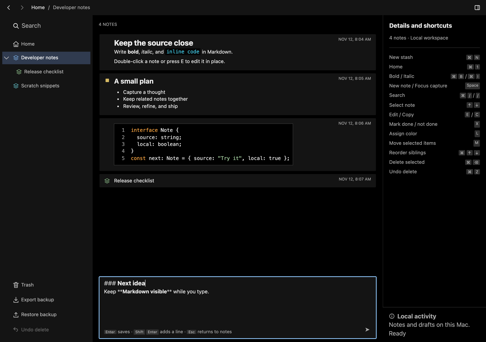
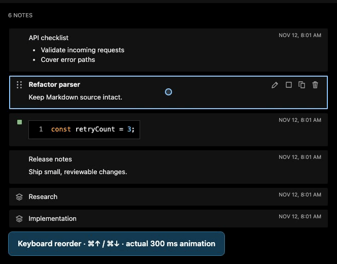
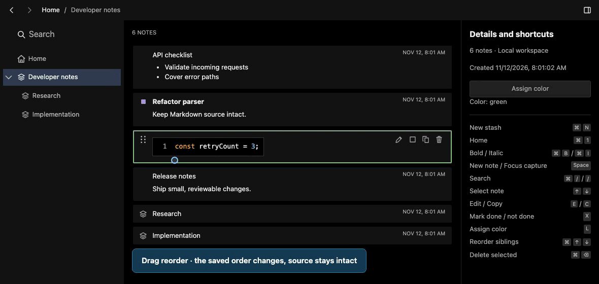

# Scratchtree

Scratchtree is a local-only Mac notes app for developers. Capture a thought without leaving the keyboard, write Markdown with its syntax still visible, and keep code snippets, lists, and related notes together in note trees.

Scratchtree is an independent, developer-focused Markdown notes app, inspired by Stashpad Lists. This is an early alpha for Apple Silicon Macs. Your library lives on one device; there are no accounts or automatic synchronization. You can transfer a backup manually, but restoring one **replaces the current library**.



_Current source preview with synthetic notes; see the download compatibility note below._

## See it in action





[Watch the full preview demo](docs/media/preview-demo.webm). The demos use synthetic notes in a browser fixture; the side-button events shown were simulated and the physical buttons were confirmed separately.

## Download and install

**Scratchtree alpha:** the application has its own name, native identity, note-tree terminology, and backup format. The Mac app keeps running when its window closes and returns through Command+Tab or the Dock.

**Alpha compatibility:** Scratchtree uses schema 7 and BackupV7. It starts with a new, empty local profile and does not automatically open earlier alpha data. Older exports require a one-time private conversion before import. Keep an unchanged backup and a working recovery installer until the transferred notes are verified. Breaking changes are expected during alpha.

[Download Scratchtree v0.1.0-alpha.5 for Apple Silicon](https://github.com/Barbacoa08/scratchtree/releases/download/v0.1.0-alpha.5/Scratchtree_0.1.0-alpha.5_aarch64.dmg) · [Release notes](https://github.com/Barbacoa08/scratchtree/releases/tag/v0.1.0-alpha.5)

1. Export a backup before updating, and quit older app copies. Earlier alpha exports need a prepared Scratchtree-format copy for this first renamed release.
2. Open the downloaded DMG, drag Scratchtree to Applications, and replace the existing app if prompted. Your app data is stored separately from the app.
3. Open Scratchtree from Applications. This alpha is ad-hoc signed, but is not Developer ID signed or notarized, so macOS may block the first launch.
4. If macOS shows a warning, click **Done**. Open **System Settings → Privacy & Security**, scroll to **Security**, and click **Open Anyway** for Scratchtree.
5. Authenticate if prompted, and confirm **Open**.

Only open the app if you trust the download. A managed Mac may restrict this option. See [Apple’s instructions for safely opening apps](https://support.apple.com/en-us/102445) for more information.

## Get started

- Type a note in the bottom composer and press Enter to save. Markdown markers stay visible while emphasis, lists, and code are styled.
- Select a note and press E or double-click to edit it. Press Enter outside fenced code or Escape to finish editing and keep changes.
- Press Command+N to create a child tree, or Enter/Right on a selected item to open it. Use the breadcrumb, Back/Forward controls, or mouse side buttons to navigate.
- Press Command+F to search and X to toggle completion. Command-click adds/removes selections; Shift-click selects a range. Drag or Command+Up/Down rearranges selected siblings, and M opens the move destination dialog.
- Export backups from the app to keep a separate copy of your library. Trash retains deleted items and supports restoring them.

The sections below describe editing, navigation, persistence, and development in more detail. The desktop stack is SvelteKit static output, Svelte, CodeMirror, Tauri, and native SQLite. Root is the always-visible top of the live library. Its small tree icon and separator distinguish it from the child trees below; it has no expand/collapse control. Other functional icons retain their existing appearance.

## Capture and edit

Outside fenced code, Enter saves, Shift+Enter adds a line or continues a list, and Command+Enter also saves. Inside a fenced code block, all three insert a code line; move outside the fence to save with Enter, or use Save note. Opening and closing delimiter lines count as code, and an unclosed fence stays code through the end of the source. Empty captures are rejected, and the composer clears only after acknowledgment. Markdown delimiters remain visible while emphasis, all six distinct heading levels, lists, and code are styled. Command+B and Command+I toggle bold and italic on the actual source. A selection stays selected inside the new markers; an empty caret inserts paired markers, or removes its enclosing style when already formatted. Bold and italic combine, and removing one keeps the other. Formatting leaves inline and fenced code unchanged, and ambiguous partial delimiter selections are left untouched. Each command is one Undo step. Standard copy, paste, selection, and undo operate on the actual source. LF, CRLF, and mixed source separators remain intact through edits and undo. New typed line breaks use the existing first separator, or LF when the document has none. Raw paste/input separators are retained when the browser exposes them; OS clipboard conversion remains a platform limit.

Typing the third opening backtick on an otherwise empty plain line, with zero to three leading spaces and one caret at its end, immediately adds a matching closing fence on the next line. A single typed input containing exactly three backticks also works. The caret stays after the opening ticks for language-info typing; Enter then inserts the body line before the closer. The triggering input and generated closer undo and redo atomically, using normal editor history and Redo caret behavior. Consecutive extra backticks extend only that newly generated pair; moving the caret or typing anything else ends that pairing ownership. Existing valid closers, direct inputs of four or more ticks, pasted/dropped text, selected text, multiple carets, composition, read-only input, inline code, existing fenced code, list/quote contexts, and tilde fences receive no automatic pair. Existing source bytes and separators stay intact. The drawn caret retains normal blinking and its full stroke at blank and start-of-line positions inside the editor scrollport.

Single click selects a card. Double click, Edit, or E opens inline editing for either kind of item. E places the caret at the source end every time, including cached edits; pointer editing retains the cached caret. Existing-item edits save after 300 ms idle. Outside fenced code, Enter finishes editing; Escape always finishes editing. Both keep changes and leave the same note selected for immediate E. Clicking away saves and exits while preserving the new target and focus. Navigation flushes the latest visible source. Saved note bodies grow naturally up to 24rem. Overflowing notes expose a full-width Expand/Collapse bar with one trailing directional chevron; expanded bodies grow up to 48rem and then scroll internally. Expansion follows each exact note ID for this editor session and survives promotion, soft deletion, and Undo, and resets after full backup replacement. Inline editing enters at the rendered body’s footprint, including when raw links or fence markers are taller. Changing the source lets the editor grow from that baseline to the current cap, then scroll internally; autosave preserves the grown editor, caret, and history. Emptying an existing note keeps its identity and ownership; deletion is explicit. The shortcut reference retains the selected note’s most recent editing context after finishing, and clears it when selection changes or the library is restored. Root, Trash, and each tree have independent capture drafts and cached editor history. Composer and inline drafts are independent; Escape from the composer preserves its text and the prior highlight, and focuses the stream. Up with one empty caret at source offset zero selects the last visible note, skipping child trees, and focuses the stream while preserving the draft, caret, history, and search query. With no visible note, it keeps ordinary editor focus. Search filters saved source globally and case-insensitively, shows each result’s owning path, keeps the capture destination visible, and labels any active edit outside the results. Sidebar navigation clears search; editing a search result preserves its query and the current capture destination. Search includes saved tree source. Root search excludes effectively deleted trees; Trash search searches only trashed saved source; its created-time/ID order is separate from sibling order.

Command+N creates an Untitled child inside the valid selected visible item, including an inline edit or search result. A selected note becomes a tree atomically with child creation, retaining its exact ID, source, completion, color, parent, and position. With no selection, Command+N uses the current location. The new empty child opens with composer focus. Leaving a tree with no saved children turns it back into a note, preserving its source, identity, and composer draft. Enter/Right can open it again; history skips destinations that are no longer trees. Clicking blank stream background safely flushes an active edit and clears the selection; Escape from the composer preserves the prior highlight. Containers have ordinary source editing, copy, completion, and deletion actions; there is no Rename dialog or separate trimmed name field. Empty existing source remains valid. Sidebar and location labels use bounded source previews, and deep rows retain limited indentation and their actual level.

Space outside controls focuses capture. Command+/ or Command+F focuses search from editors or the stream; / also focuses search outside controls. Command+1 opens Root after flushing the latest source. Hold Command to reveal anchored Search and Root hints without moving content or focus; Escape clears search and focuses the stream. Up/Down selects cards. Enter/Right opens any selected stream item, promoting a note while preserving its identity and source. Empty destinations focus the composer; nonempty destinations restore the last valid selection or select their first entry with stream focus. Left outside controls opens the parent and selects the tree just exited. Double click edits source. X toggles completion for either selected kind without hiding it or changing Markdown. Completed items stay searchable, use subdued strike-through in saved rendering, and remain legible while editing. The Mark done toggle keeps its accessible name, exposes its pressed state, and changes its tooltip to describe the next action. Held X, modifiers, composition, text selection, and typing controls do not toggle completion. E edits at the source end, C copies exact saved Markdown or the active source buffer, and Command+Backspace deletes either kind without confirmation. Deletion selects the successor at the same visible ordinal, otherwise the previous item, otherwise the composer. Single-letter shortcuts leave text inputs, selection, composition, and confirmations alone. Copy failure is shown without changing source. M moves selected siblings to an eligible tree, Root, or Trash. Moving from the live library into Trash creates one undoable group; moving back restores the selected items at the chosen destination and keeps independently deleted descendants in Trash.

The unified title strip contains Back/Forward session history and a clickable breadcrumb. Mouse side buttons Back/Forward use that same app history once on release, including over editors; their URL-history default is consumed at boundaries and while blocked. History retains up to 100 acknowledged visits, including distinct Root and Trash roots. A new visit after Back replaces the forward branch; failed navigation does not move the cursor, and a successful captured Retry records or completes its original visit. Missing trees and entries whose recorded live/Trash scope has changed are skipped. Structural deletion/restoration reconciles the current slot, and full backup replacement resets the session history. History and breadcrumb navigation flush source and never promote a note. The breadcrumb shows the scope root, at most the last two source previews, and an omitted-ancestor count for deeper paths; Trash ancestry stops at the explicit deleted root. Left remains available for successive parent navigation within the current scope.

Show/Hide Details works at every width. Before a deliberate choice, Details is shown on wide windows and hidden at 1050px or narrower; a session choice survives later resizing. Collapsing releases the wide column, removes the rail from keyboard and accessibility navigation, and moves focus from its contents to the toggle. Expanding on resize retains Search/editor focus. Editor status and its local-save explanation remain at the bottom of expanded Details. While collapsed, normal status remains announced without occupying space, and actual errors, bounded color context, and captured Retry controls appear in a compact scrollable panel at the lower right. The panel does not change editor geometry. A simultaneous failed palette has separate scroll space so its controls and pointer Retry remain reachable.

L outside typing controls opens Assign color for the selected item; Details also exposes Assign color. The named nonmodal palette contains a two-column layout grid of nine fixed-color swatches and an icon-only Reset. Names remain accessible to assistive technology; no color-name text is shown visually. Arrow keys stage a choice by row and column without changing the saved color; boundaries stop, Home/End move within a row, and the pressed state and check mark identify the saved color. Enter, Space, or clicking applies the exact choice once and closes after acknowledgment. Escape, outside focus/pointer, and Tab dismiss an unsubmitted or failed choice without writing; pending dismissal requests leave the picker visible while external controls remain usable. Failure retains the exact item and color for Retry action, with bounded item context in Editor status. Successful retry only closes its own session and never takes newer Search focus. There is no Done button. Colors affect the note gutter marker, tree icons, and the selected nonediting card border, leaving source text contrast unchanged. Uncolored selection stays gold; editing stays blue. Reset removes a note's square. Color, completion, and source stay attached to the same ID through promotion, Trash, Restore, and backups.

Plain click selects one item, Command-click toggles an item, and Shift-click selects the inclusive displayed sibling range from the original anchor. Shift with no valid anchor selects only the clicked item; releasing and holding Shift again retains a valid anchor. Edit, color, completion, copy, delete, and Command-N act on the primary selected item. Global search remains single-result selection, and keyboard range selection is deferred. Command+Up/Down outside editors gathers the selected siblings into one displayed-order block at the first selected position, then moves that block one place. Movement clamps to the remaining sibling gaps: a nonadjacent selection can gather at an edge, while an already contiguous edge block stays put. Group dragging inserts the selected items together in source order. One fixed gutter slot supports before/after insertion in the same sibling group, including mixed notes and trees in Root, containers, and Trash. Notes show the grip on hover, selection, or keyboard focus. Trees keep their stack on selection and keyboard focus, swapping it for the grip only during pointer hover. The named Reorder note control remains keyboard reachable with a visible focus ring. The handle also accepts Command+Up/Down and retains focus. Successful sibling reorders move the real cards into place over 300 ms with a decelerating, position-only animation. Reduced motion makes movement immediate and settles any running motion. Scrolling, resizing, hiding, navigation, and a new drag settle cosmetic movement; existing nearest-item visibility still takes priority. Failed or unchanged moves, source edits, membership changes, and search receive no new movement. Already contiguous boundary blocks and unchanged moves are neutral. Owned self, no-op, and background drag positions explicitly reject copying; valid insertion shows move feedback and a guide. Search results cannot be reordered; open their containing tree first. Drags never reparent, accept foreign payloads, or move between scopes. M opens a named modal for cross-parent movement within or between the live library and Trash. Arrows and clicks stage a destination; Enter or Move confirms. Cancel, Escape, and backdrop clicks before submission close it without writing. Self and descendant destinations are excluded. An already submitted move retains its captured intent until acknowledgment or explicit Retry; later selection cannot retarget it. Source flushes before movement, failed metadata actions retry their captured item/color/destination without capturing a draft, and newer navigation or focus retains control. Held Command reveals anchored Search, Root, New tree, Reorder, and Delete hints without moving content.

Saved rendering uses markdown-it with raw HTML disabled. Images become descriptive text and never fetch. JS/TS/JSON fences use Lezer highlighting; other code is escaped. Only explicit HTTP(S)/mailto link activation may open an external application; native validation repeats the frontend scheme/length checks. The narrow native clipboard command writes text only. Neither plugin grants frontend file-opening, shell, clipboard-reading, or general opener permissions.

## Run and verify

Use Node 24.21.0, pnpm 12.4.1, Rust 1.99.1, and the macOS Xcode command-line prerequisites. Direct package and crate versions are pinned; commit both lockfiles when deliberately updating them. Select the required Node and Rust toolchains in your shell before running commands, including Tauri's child commands.

```sh
pnpm install --frozen-lockfile
pnpm dev
pnpm tauri:dev
pnpm verify
pnpm tauri:build
```

The frontend owns sibling drag and drop. Keep the native window’s `dragDropEnabled` set to `false` so its file-drop handler does not consume HTML drag events. The editor rejects file drops before editors can import them and cancels unhandled background drops. Ordinary text dropped into an editor stays editable source with Undo/Redo.

`dev` opens a web development server; native storage requires `tauri:dev`. The browser-only synthetic editor is available at `http://127.0.0.1:4511/?fixture` during development; add `&visual` for fixed public Markdown examples. It uses an in-memory test repository that resets on reload, not SQLite or a native profile. The ordinary browser URL does not provide a browser persistence fallback.

`check` runs Kit type generation, Svelte/TypeScript checks, and formatting. `test:unit` checks framework-neutral policy and controller ordering. `test:browser` starts a strict loopback fixture server at port 4611 and runs Chromium tests with an injected synthetic repository. Install Playwright's matching Chromium if absent. The normal development server uses strict loopback port 4511. `build:web` produces static `build/` assets with no runtime server; `tauri:build` produces an unsigned aarch64 Mac `.app` without a DMG, signing, or publication. Rust tests use disposable file databases and validate actual SQLite persistence and recovery. Browser tests establish browser behavior, not native WebKit, IME, or screen-reader acceptance.

Kit 3 config lives in `vite.config.ts`; `src/routes/+layout.ts` disables SSR. The sole root route mounts the editor. Browser fixture code is behind a development-only branch and must not appear in production client assets. No server routes, remote functions, or application network service are present.

## Persistence and backups

Capture saving is explicit. Capture drafts checkpoint after 300 ms idle; existing-item source commits after the same idle interval without leaving the editor. Pending source flushes before deliberate navigation, export, restore, deletion, and normal close. “Saved” appears only after native acknowledgment. Input typed during a save remains in its own context and is included in the next commit or checkpoint. Failed note saves retain visible source and attempt a recovery checkpoint; retry must succeed before finishing or navigation. Forced termination or power loss can lose input before its checkpoint; window-close failures keep the window open with Retry and hide, Keep window open, or Hide without saving. Hiding without saving retains input in memory, without claiming it reached disk.

Completion waits for the latest source flush, then persists an explicit desired boolean. Repeating the same desired state is a no-op, including its timestamp. A failed source flush or completion write retains the source and completion intent; Editor status offers Retry completion for that exact item and state, without submitting capture.

Delete in the live library retains the complete tree in Trash, with one persistent deletion Undo action. Ordinary Delete records one item; M into Trash records all moved items in source order. One Command-Z restores the whole remaining group atomically to its remembered locations. If a member is separately restored or permanently deleted, the other members remain undoable. Command-Z outside typing controls, text selection, composition, repeat, busy, palette, and modal contexts invokes that same Undo; it never intercepts editor/Search text Undo or Shift-Command-Z, and duplicate pending Undo requests are blocked. Delete inside Trash permanently removes the selected item and its parent-edge children, without Undo or a new safety backup. It does not remove independently detached deleted roots; surviving restore pointers and Undo membership are repaired, and only acknowledged removed items lose their draft/editor caches. This is logical deletion from the current library, not secure erasure of SQLite storage or existing backups. Source flush failure blocks the action and preserves its exact retry intent. Restore uses a remembered live owner, promoting a note if needed, otherwise Root, and clamps the remembered ordinal. Individually restoring an inherited child carries its non-independently-deleted contents to Root. Independent nested deletion records remain in Trash when an ancestor restores. Source buffers, scoped drafts, editor histories, completion, and color survive ordinary promotion, empty demotion, soft deletion, movement, and restoration. Failed actions retain their captured intent without submitting a capture draft or taking newer Search focus. Retained items have no automatic permanent cleanup timer; the minimum 90-day retention excludes explicit user-requested permanent deletion. Parent navigation and search stay within the current live or Trash scope, and restoring an opened tree follows its live location.

Native storage is `notes.sqlite3` under `~/Library/Application Support/tech.barbajoe.scratchtree.preview` on macOS. The product/window name is Scratchtree. New profiles initialize directly in schema 7; the current app accepts only that schema and its current backup contract. It never reads an earlier application profile or the original third-party app's store automatically. Every entry owns its Markdown, identity, metadata, and parent relationship; a note can be opened as a tree without replacing that entry.

The full prospective schema-7 envelope is validated before replacement or mutation. Invalid data, unsupported schemas, and over-capacity envelopes are rejected without changing prior notes, settings, or the schema version. Limits are 20,000 notes, 40,002 drafts, 1 MiB UTF-8 per source, and 10 MiB for the complete compact backup. Preserve rejected files and recovery copies. Read failure offers Retry instead of silently opening an empty library.

Export uses a native destination dialog and atomic temporary-file replacement. BackupV7 contains `{format: "scratchtree-alpha", version: 7, exportedAt, library}`, with only `items`, `drafts`, and ordered `undoDeleteIds` inside `library`. Every item requires its exact UUID, nullable `parentId`, `kind` (`note` or `tree`), full `markdown`, boolean `done`, nullable fixed `color`, sibling `position`, creation/update timestamps, and nullable deletion/restore metadata. Capture drafts use `compose`, `compose:<exact UUID>`, or `compose:trash`; source drafts use the exact item ID. The Undo array uses unique exact IDs of explicitly deleted entries and is empty when no deletion action is pending. Unknown fields, ambiguous IDs, cycles, duplicate sibling positions, invalid colors, and invalid deletion/restore metadata reject before mutation. Restore stages an immutable validated snapshot, shows replacement counts, requires confirmation, writes a safety backup into the app data directory's `backups` folder, and replaces the library transactionally while retaining unknown settings. Failure preserves prior data and permits retry; cancelled dialogs are neutral. Only successful full replacement resets every editor cache; permanent purge prunes just its acknowledged removed IDs.

Current ceilings are 20,000 items, 40,002 drafts, 1 MiB UTF-8 per source field, and 10 MiB for the complete compact backup envelope. Counts do not guarantee that source and metadata fit the envelope. Each creation intent carries a caller-generated UUID that stays fixed through retry. Matching replay is neutral; conflicting identity rejects without overwrite. After capture failure, a successful authoritative library read may retire the pending request only when its UUID is absent, allowing corrected input to form a new intent. If the item exists or the read fails, the original UUID, source, location, and acknowledgment revision remain fixed for retry; error codes alone do not establish whether the write committed. Parent promotion and child insertion commit together. Reorder is sibling-only; M allows cross-parent movement in either area. Captured before/after group orders support neutral exact replay and reject stale structural intent. Only actually moved roots change content timestamps. Structural rank normalization leaves neighbors' content timestamps unchanged.

Client rendering errors show a readable diagnostic panel and an explicit Reload view control. Submitted notes may already be saved; uncheckpointed input may be lost on reload. Diagnostics retain only a reference, app version, time, error class/status, and sanitized app-module locations. At most three small records stay in browser local storage, with three write attempts per page load; storage failure does not block the panel. Select the displayed details to copy them when reporting a problem. Note contents, raw error messages, arbitrary paths, and query strings are excluded, and nothing is sent to a service.

## Native acceptance

Closing the Mac window (red close control or Command+W) flushes pending edits and hides the application without destroying its window or editor session. Switch back with Command+Tab or click the Dock icon to show that same window, preserving its location, drafts, selection, editor history, and frame. Command+Q and the native Quit menu still fully quit. Direct Quit retains its existing native behavior; input that has not reached its 300 ms checkpoint can be lost, so closing the window first provides the explicit flush safeguard.

The normal native window frame is saved separately in `window-geometry.json` under the Preview app-config directory. Position and dimensions restore after page load; a reachable titlebar permits exact spanning/partial-offscreen placement, while inaccessible placements clamp to available work areas. Minimized, maximized, and fullscreen states reopen normally at the last captured normal frame. Corrupt or unavailable preferences do not block the note library.

Run the packaged `.app` without Vite. Use synthetic notes and native dialogs to check offline reopen, exact Markdown/caret behavior, commands, draft close/reopen, delete/undo, and backup/restore. Confirm keyboard focus, 800×600 reflow at 150% text, and actual IME input separately. The Mac overlay title bar retains real native traffic lights and reserves their space; inspect native dragging/control exclusion, fullscreen entry/exit, and matching titlebar/sidebar colors. Browser fixtures render no imitation native controls. Only the narrow start-drag permission is added; the existing core default supplies native title-region double-click behavior. Browser tests include a synthetic composition event, which does not establish native IME acceptance. Record source/build identity, environment, results, and omissions under an ignored dated `.projects/` folder.

Automated adoption verification does not establish packaged native behavior. Native builds and smoke checks are separate gates; record any unperformed steps explicitly. Use only the Preview profile and synthetic data. Do not access the installed original app, personal stores, or experimental profiles.

For debug-only native failure checks, set `SCRATCHTREE_ALPHA_TEST_FAILURE_FILE` to a task-owned text file before launching the debug executable. File content `load`, `save`, `checkpoint`, or `completion` rejects that operation before mutation; clear the file to retry. This environment seam is compiled out of release builds and has no product UI control. Debug failure checks do not establish release acceptance.

## Boundaries

Domain/search/backup/rendering policy is in `src/lib/domain`; the framework-neutral controller owns keyed edit buffers, draft revisions, and serialized persistence in `src/lib/workspace`; capture acknowledgments clear only the acknowledged source revision; promotion, soft deletion, and restoration preserve buffers, while successful backup replacement replaces all buffers; the typed command boundary is in `src/lib/platform`; Svelte components own view/CodeMirror lifecycle. Rust model, store, backup, and narrow commands live in `src-tauri/src`. Later sync can operate behind the repository boundary, but revisions, ordering, conflicts, authentication, and recovery require a separate design. Mobile platform integration and editor/keyboard acceptance are also separate work. Accounts, network sync, phones, attachments, production signing and notarization, and original-app import remain future work or outside this alpha. The ad-hoc signed Apple Silicon prerelease is available in [Download and install](#download-and-install).

See [AGENTS.md](AGENTS.md) for repository responsibilities, [CONTRIBUTING.md](CONTRIBUTING.md) for development and review, [DISCUSSIONS.md](DISCUSSIONS.md) for open decisions, [docs/RELEASING.md](docs/RELEASING.md) for packaging and releases, and [.projects/README.md](.projects/README.md) for evidence retention. No public license is selected.
